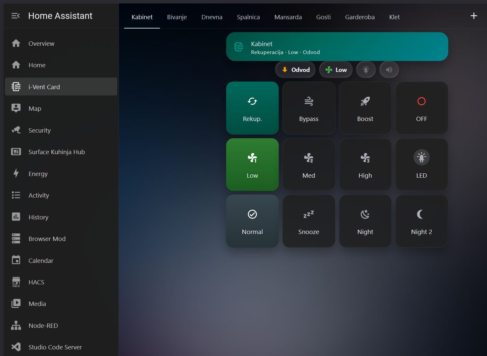
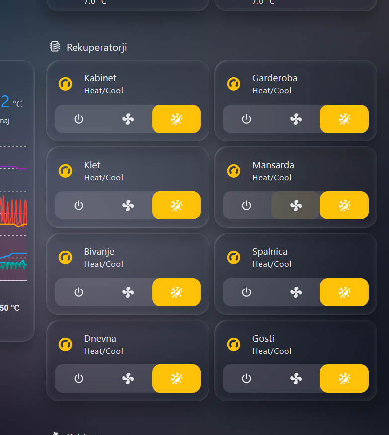
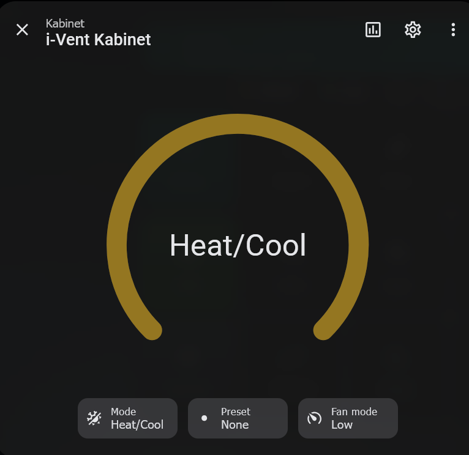
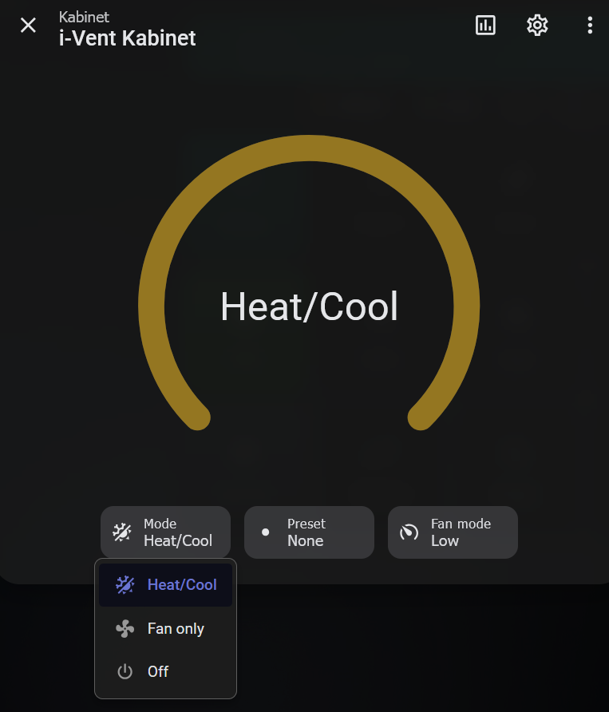
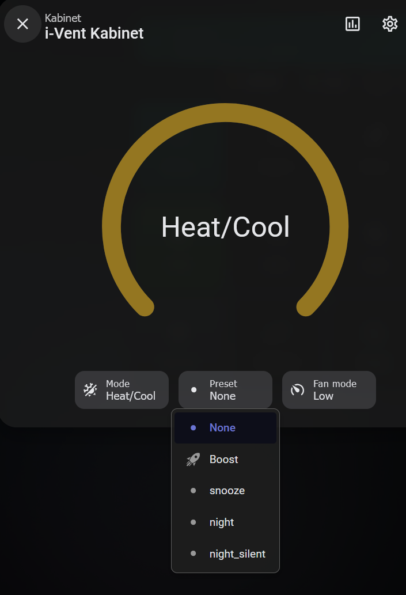
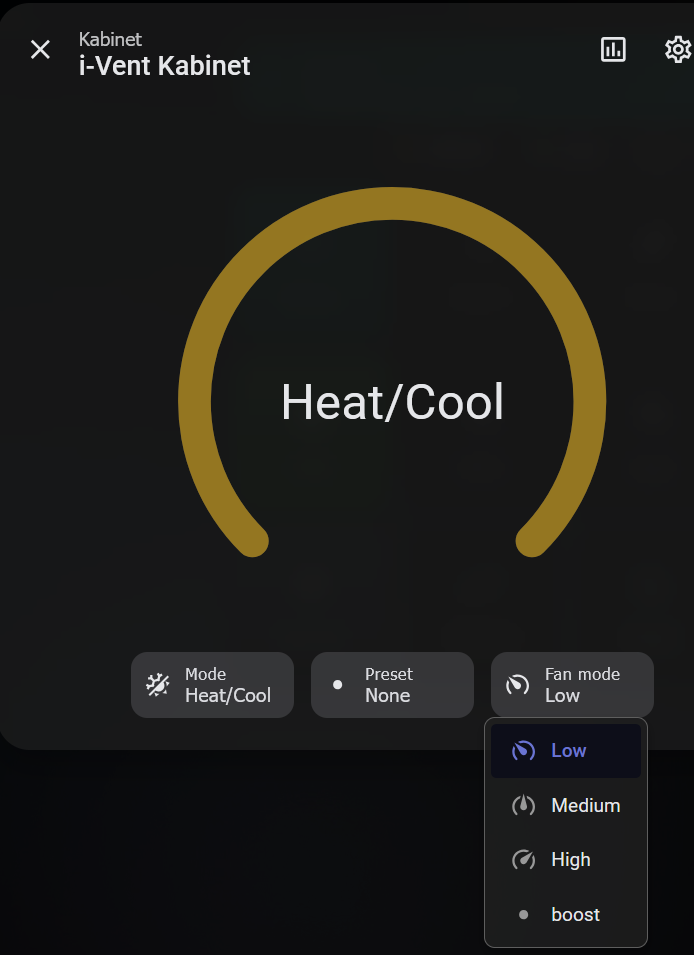

[English](README.md) | **Slovenščina**

# i-Vent rekuperator — integracija za Home Assistant

Integracija po meri (HACS) za [i-Vent](https://i-vent.com/) rekuperatorje prek **i-Vent Cloud API**.

## Posnetki zaslona

### Mobilna aplikacija i-Vent


*Izvirna aplikacija i-Vent z upravljanjem sobe: način (Rekuperacija/Bypass/Boost/IZKLOP), hitrost ventilatorja (nizka/srednja/visoka) in prednastavitve (Normalno/Dremež/Noč/Noč 2)*

### Home Assistant — pregled


*Vseh 8 enot i-Vent v Home Assistantu z vklopom, ventilatorjem in načinom delovanja*

### Home Assistant — kartica Climate


*Entiteta climate s številčnico, ki prikazuje trenutni način delovanja*

### Home Assistant — izbira načina


*Načini delovanja: Heat/Cool (rekuperacija), Fan only (prezračevanje), Off (izklop)*

### Home Assistant — prednastavitve


*Prednastavitve: brez, Boost, Snooze (dremež), Night (noč), Night Silent (tiha noč)*

### Home Assistant — hitrost ventilatorja


*Hitrost ventilatorja: nizka, srednja, visoka, boost*

## Zakaj je to uporabno

i-Vent rekuperatorji nimajo uradne integracije za Home Assistant. Ta integracija prenese celoten prezračevalni sistem v HA in omogoča:

- **Osrednji pregled** — vse rekuperatorje vidite na eni nadzorni plošči, namesto da v aplikaciji i-Vent preverjate vsako sobo posebej
- **Upravljanje načina** — preklop med rekuperacijo, prezračevanjem in izklopom za vsako sobo
- **Upravljanje hitrosti** — nizka, srednja, visoka ali boost za vsako enoto
- **Smer pihanja** — vidite, ali enota trenutno piha noter (dovod) ali ven (odvod)
- **LED in brenčač** — vklop in izklop LED lučke in brenčača na vsaki enoti
- **Avtomatizacije** — boost med kuhanjem ali ko je CO₂ visok, izklop spalnic ponoči, nižja hitrost, ko ni nikogar doma

## Ali potrebujete i-Cube?

[i-Cube](https://i-vent.com/si/prezracevalni-sistemi/i-cube/) je brezžični senzor kakovosti zraka podjetja i-Vent. Meri CO₂, VOC, vlago in temperaturo ter samodejno prilagaja do 4 cone i-Vent. Je dober izdelek, če želite rešitev »priključi in deluje«, **a če že uporabljate Home Assistant, lahko to integracijo skupaj s katerimkoli senzorjem kakovosti zraka, ki ga že imate, opravi isto delo** — običajno ceneje in bolj prilagodljivo.

| | i-Cube | Home Assistant + ta integracija |
|---|---|---|
| **Cena** | ~249 € + DDV (≈ 304 €) | integracija je brezplačna + senzor, ki ga že imate (ali npr. IKEA VINDSTYRKA / Aqara, ~30–60 €) |
| **Senzorji** | CO₂, VOC, vlaga, temperatura, tlak — na eni lokaciji | poljubno število senzorjev, v vsaki sobi, katerakoli znamka, ki jo HA podpira |
| **Logika upravljanja** | vgrajeni pragovi i-Vent | vaše lastne avtomatizacije: CO₂, vlaga, prisotnost, ura, vreme, okenska tipala, kuhanje … |
| **Cone** | do 4 | vse skupine i-Vent na vaši lokaciji |
| **Povezava s preostalim domom** | ne | da — luči, prisotnost, koledarji, obvestila na telefon |
| **Deluje brez interneta** | da (lokalna povezava i-Vent) | trenutno prek i-Vent Cloud API — **lokalno upravljanje je v razvoju** |
| **Zahtevnost namestitve** | postavite in povežete | namestitev, nastavitev in nekaj avtomatizacij |

**Na kratko:** brez Home Assistanta je i-Cube preprosta izbira. Če že uporabljate Home Assistant, ga najverjetneje ne potrebujete.

> Opomba: same enote i-Vent **nimajo senzorja temperature, vlage ali CO₂** (preverjeno v protokolu naprave). Kakovost zraka v prostoru mora vedno priti iz ločenega senzorja — bodisi i-Cube bodisi senzorja v Home Assistantu.

### Primer: boost pri visokem CO₂

```yaml
automation:
  - alias: "i-Vent: boost pri visokem CO2"
    triggers:
      - trigger: numeric_state
        entity_id: sensor.dnevna_co2
        above: 1200
        for: { minutes: 5 }
    actions:
      - action: fan.set_preset_mode
        target: { entity_id: fan.i_vent_dnevna_ventilator }
        data: { preset_mode: boost }
```

## Znano obnašanje: samodejni nočni način

Nekatere namestitve vsak večer preklopijo **vse sobe** v nočni način (1 h stopnja 2, nato 8 h »tiha noč«), ne da bi kdo pritisnil gumb — najverjetneje ga sproži svetlobni senzor, ko se prostor zatemni. V Home Assistantu se to vidi kot `fan_only` s prednastavitvijo `night` / `night_silent`. Če tega ne želite, sobe z majhno avtomatizacijo vrnete v rekuperacijo:

```yaml
automation:
  - alias: "i-Vent: brez samodejnega nočnega načina"
    mode: parallel
    triggers:
      - trigger: state
        entity_id: [climate.i_vent_dnevna, climate.i_vent_kabinet]   # vaše sobe
        attribute: preset_mode
        to: [night, night_silent]
        for: { minutes: 1 }
    actions:
      - action: climate.set_hvac_mode
        target: { entity_id: "{{ trigger.entity_id }}" }
        data: { hvac_mode: heat_cool }
      - delay: { seconds: 10 }
      - action: climate.set_fan_mode          # sam heat_cool obdrži nočno hitrost
        target: { entity_id: "{{ trigger.entity_id }}" }
        data: { fan_mode: low }
```

## Predpogoji

Iz platforme i-Vent Cloud potrebujete dve vrednosti:

1. **API ključ** — vaš žeton za overjanje s [cloud.i-vent.com](https://cloud.i-vent.com)
2. **ID lokacije** — številčni ID vaše namestitve i-Vent

### Kako pridobite API ključ in ID lokacije

1. Prijavite se na [cloud.i-vent.com](https://cloud.i-vent.com)
2. V brskalniku odprite orodja za razvijalce (F12) → zavihek Network
3. Pobrskajte po nadzorni plošči in poiščite zahteve na `/api/v1/live/...`
4. Glava `Authorization: Bearer <žeton>` vsebuje vaš **API ključ**
5. Pot v URL-ju `/live/{številka}/info` vsebuje vaš **ID lokacije**

## Namestitev

### HACS (repozitorij po meri)

1. V HACS odprite Integrations → ⋮ → Custom Repositories
2. Dodajte URL tega repozitorija, kategorija: Integration
3. Namestite »i-Vent Rekuperator«
4. Ponovno zaženite Home Assistant
5. Odprite Settings → Devices & Services → Add Integration → i-Vent
6. Vnesite API ključ in ID lokacije

### Ročno

1. Kopirajte `custom_components/ivent/` v mapo `config/custom_components/` v HA
2. Ponovno zaženite Home Assistant
3. Odprite Settings → Devices & Services → Add Integration → i-Vent
4. Vnesite API ključ in ID lokacije

## Entitete

Vsaka enota (skupina) i-Vent ustvari naslednje entitete:

| Platforma | Entiteta | Opis |
|----------|--------|-------------|
| `climate` | i-Vent {ime} | način delovanja (rekuperacija, prezračevanje, izklop), hitrost, prednastavitve |
| `fan` | {ime} Ventilator | vklop/izklop in hitrost ventilatorja (nizka/srednja/visoka/boost) |
| `sensor` | {ime} Smer pihanja | smer pihanja (Dovod / Odvod) |
| `switch` | {ime} LED | vklop/izklop LED lučke |
| `switch` | {ime} Buzzer | vklop/izklop brenčača |

## Načrt razvoja

- [ ] **Lokalna diagnostika prek UDP** — dejanska hitrost ventilatorja (noter/ven v %), obrati in tok motorja, moč signala Wi-Fi in statusne kode, prebrane neposredno iz vsake enote (brez oblaka). Enote ne poročajo temperature, vlage ali stanja filtra.
- [ ] **Lokalno upravljanje** — preklop načinov prek lokalnega protokola, da integracija deluje tudi brez interneta
- [ ] **Podpora več lokacijam** — več lokacij i-Vent v enem Home Assistantu
- [ ] **Privzeti repozitorij HACS** — oddaja v privzeti repozitorij HACS, ko bo integracija stabilna

## Licenca

MIT
